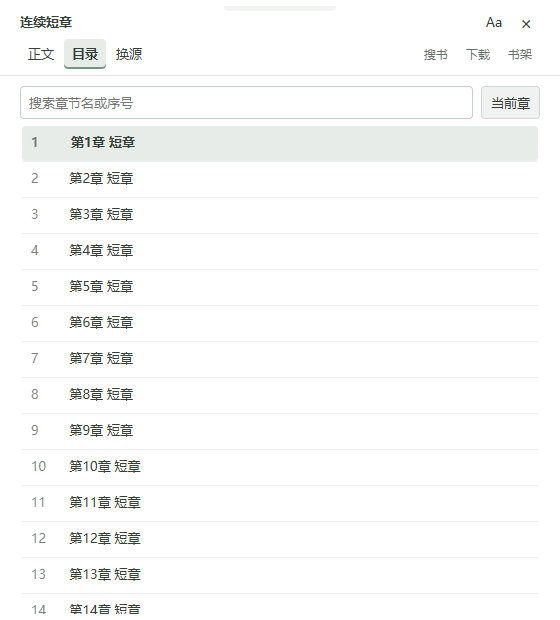

# 页间 · Page Between

**网页之间，偷闲几页。**

[](https://github.com/MaSiBo1998/page-between/releases/latest)
[](https://github.com/MaSiBo1998/page-between/actions/workflows/ci.yml)
[](LICENSE)

一款集小说下载、在线阅读和 TXT 阅读于一体的浏览器扩展。无边框悬浮窗，可拖动、可缩放、可调透明度，让阅读融入当前网页，工作间隙也能轻松摸鱼。

下载、阅读、书架共用一个网页浮窗，切换功能无需新开标签页；隐藏浮窗不影响后台下载。书籍与阅读进度默认仅保存在本机，无账号、云同步或统计埋点。

**[下载最新正式版](https://github.com/MaSiBo1998/page-between/releases/latest)** · **[完整图文使用手册](docs/user-guide.md)** · [更新记录](CHANGELOG.md) · [反馈问题](https://github.com/MaSiBo1998/page-between/issues)



## 下载安装

普通用户只需下载安装包，无需安装 Node.js 或自行构建。目前通过**开发者模式加载**安装，尚未发布到 Chrome 网上应用店或 Edge 加载项商店。

1. 在 [GitHub Releases](https://github.com/MaSiBo1998/page-between/releases/latest) 的附件中下载 Chrome / Edge 通用安装包（0.1.3 对应 `page-between-0.1.3-chromium.zip`），解压到一个准备长期保留的文件夹。
2. 打开扩展管理页：Chrome 输入 `chrome://extensions`，Edge 输入 `edge://extensions`。
3. 开启「开发者模式」，点击「加载已解压的扩展程序」。
4. 选择解压后的文件夹，确认该文件夹内直接包含 `manifest.json`。不要选择 ZIP 文件或 GitHub 的 `Source code` 源码包。
5. 在浏览器工具栏固定「页间」，打开一个普通网页，点击扩展开始使用。首次读取某网站时，根据提示授予该网站权限。

可选：从同一 Release 下载对应的 `.sha256` 校验文件。Windows PowerShell 可使用 `Get-FileHash .\page-between-0.1.3-chromium.zip -Algorithm SHA256` 核对文件摘要。

更新时先导出重要内容，再用新版文件替换原安装目录中的文件，并在扩展管理页点击「重新加载」。保留原安装路径、避免先卸载扩展；本地数据仍建议自行备份。

## 浏览器支持

| 浏览器 | 当前状态 | 版本与说明 |
| --- | --- | --- |
| Google Chrome 桌面版 | 已验证 | 最低要求 Chromium 116；Windows 上使用 Chrome 157 完成集成验证 |
| Microsoft Edge 桌面版 | 已验证 | 最低要求 Chromium 116；Windows 上使用 Edge 153 完成集成验证 |
| 其他 Chromium 桌面浏览器 | 未验证 | 取决于 Manifest V3、Offscreen 等扩展 API 支持，不保证兼容 |
| Mozilla Firefox | 暂不支持 | 本版未提供 Firefox 构建及适配 |
| 手机浏览器 | 暂不支持 | 本版面向桌面浏览器 |

Chrome 与 Edge 使用同一个安装包。最低版本来自扩展配置，不代表已在每个历史版本上实测；macOS、Linux 尚未进行实际安装验证。浏览器版本和测试边界见[验证记录](docs/testing.md)。

## 核心功能

| 功能 | 说明 |
| --- | --- |
| 网页悬浮阅读 | 无边框浮窗，支持拖动、缩放、透明度、宽度、字体、字号、颜色和行距调整 |
| 连续阅读 | 仅保留附近正文，缓存有上限，长时间前后翻读不累积整本正文节点 |
| 同窗切换 | 阅读、下载、书架共用浮窗，切换或隐藏不暂停后台任务 |
| 在线阅读 | 导入目录网址或带目录链接的正文网址，按需读取当前章及全部分页，完整章节本机缓存 |
| 搜书与换源 | 在后台查找 Bing 首页结果，逐站验证来源；切换已关联的来源时匹配同章或手选章节 |
| 来源下载 | 在「下载」管理任务与配置，或从「搜书」结果直接验证并下载 |
| 并发调度 | 默认 6 并发，每隔随机 200～600 毫秒启动请求，遇限流自动降速 |
| 分页处理 | 支持目录分页、正文分页、重复链接检查及章节顺序检查，乱序完成仍按目录顺序导出 |
| 后台任务 | 暂停、继续、取消、部分导出；关闭浮窗或来源页后继续，浏览器重启后可手动续抓 |
| TXT 与本地书架 | 导入最大 32 MiB 的 TXT，支持 UTF-8、UTF-16 BOM、GBK，重复导入识别、删书和阅读位置保存 |
| 网站适配 | 结合站点规则与通用解析；样章验证通过不等于整本下载已验证 |

网站支持情况请查看[站点报告](docs/sites.md)。需要登录、订阅、验证码、特殊字体或专用动态接口的网站，可能无法取得正文。

## 使用方法

### 下载小说

1. 打开「下载」，可保存并发数与请求间隔，设置用于之后创建的任务。
2. 在「下载」或「搜书」搜索书名，也可粘贴网址。搜索结果支持「验证并下载」，通过按站授权和来源验证后才会启动；已验证来源可以直接点「下载」，不需要先加入书架。
3. 两个面板共用后台任务，可查看进度、暂停、继续或取消。下载完成后可「导出 TXT」或「加入书架并阅读」；暂停后也可以导出已保存的正文。

一次只运行一个下载任务。旧任务未完成时，请先导出并取消，再开始新任务；取消保留已有正文。浏览器退出或后台被回收后，任务可恢复为暂停状态，点击继续才会重新请求网站。

### 在线阅读

1. 点击浏览器工具栏「页间」→「搜书 · 验证来源」，或从浮窗顶部打开「搜书」。
2. 粘贴小说网址，点击「验证网址」，通过后选择「阅读」。
3. 开始阅读后，书籍自动加入本机书架。接近正文尾部时自动追加下一章；完整缓存的章节无需重复请求。加载失败保留已读正文，可点击末尾「重试加载」。

推荐填写完整目录网址。正文网址必须包含实际目录链接，才能定位目录和对应章节；再次打开书籍会恢复已保存的位置，无需等待整本下载完成。

### 搜书与换源

在浮窗顶部点「搜书」，输入书名和可选作者。后台搜索只读取浏览器默认搜索引擎返回的 Bing 首页普通结果，需要站点授权；不支持的搜索引擎仍可在浏览器中打开结果，或手动粘贴小说网址。只有主动要求验证并授权后才会读取候选站点的目录和样章。

搜书验证通过后，可以直接「加入书架」而不开始阅读。验证本身不会添加书籍。阅读时，将鼠标移到顶部打开「换源」，可在面板内搜索本书的其他来源。默认最多取 10 项，可在 1～50 间调整，实际数量不超过可读取的 Bing 首页普通结果。切换会尝试匹配当前章节，无法唯一匹配时可从新目录手选。目标章读不到时会保留原书和进度。

### 导入 TXT

在浮窗「书架 / 导入」选择本机 TXT 文件，最大 32 MiB。扩展支持自动检测 UTF-8、UTF-16 BOM、GBK，也可手动选择编码；没有章节标题的文件也能阅读。重复内容不会创建新书。

书架、阅读位置和样式保存在当前浏览器配置文件中，可在网页浮窗中继续使用；不会自动跨浏览器或跨设备同步。旧油猴版的数据独立保存，不会自动迁移其私有存储，已有 TXT 可以直接导入。

### 浮窗与快捷键

| 操作 | 方法 |
| --- | --- |
| 切换功能 | 顶部「正文 / 目录 / 换源」用于阅读，「搜书 / 下载 / 书架」另列 |
| 移动浮窗 | 在正文、标题或任意面板空白处按住左键移动即可拖动，无需长按。正文不可选字，按钮和输入框保留原操作 |
| 连续阅读 | 下一章自动接在正文后面，无需点击下一章；目录和进度跟随当前阅读位置 |
| 滚轮翻屏 | 正文内一次滚轮手势翻一屏，保留一行上下文；搜书、书架和网页其他区域保持普通滚动 |
| 查找章节 | 打开顶部「目录」，滚动自动加载后续条目；也可搜索或定位当前章 |
| 调整大小 | 拖动任意一边调整单轴，或拖动角落同时调整宽高 |
| 调整阅读样式 | 点击 `Aa`；字号默认 14 px，有效输入立即生效。点击正文或上箭头收起 |
| 隐藏 / 恢复 | 默认 `Alt+R`；在阅读设置中直接按组合键，或输入如 `Alt+K` 并回车 |
| 隐藏浮窗 | `Esc` |
| 在当前网页直接显示阅读器 | `Alt+Shift+1`，首次在该网页使用也可唤起 |
| 直接隐藏整个阅读浮窗 | `Alt+Shift+2` |
| 显示顶部控制栏 | `Alt+Shift+3` |
| 隐藏控制栏，保留正文 | `Alt+Shift+4` |

浏览器级快捷键可在 Chrome 的 `chrome://extensions/shortcuts` 或 Edge 的 `edge://extensions/shortcuts` 修改。若被其他扩展占用，请在该页面重新分配。网页或浮窗的输入框获得焦点时，`Alt+R` 和「直接隐藏阅读器」仍可隐藏整个浮窗，单按 `Esc` 不会打断输入。网页刷新后浮窗默认收起，点击扩展或使用直接显示快捷键恢复；隐藏只影响显示，不暂停下载。

阅读态默认使用不透明白底、窄边距，底部不显示章号或进度。顶栏默认隐藏，鼠标移到浮窗顶部或用键盘聚焦即可显示，正文位置不会因悬停变化。可在 `Aa` 选择始终显示或沉浸隐藏；已有自定义背景与透明度保留。

## 开发指南

技术栈：**WXT + TypeScript + React + Manifest V3**。本地开发需要 **Node.js 22.13+** 和 npm。

```sh
git clone https://github.com/MaSiBo1998/page-between.git
cd page-between
npm ci
npm run dev
```

| 命令 | 用途 |
| --- | --- |
| `npm run dev` | 启动开发构建 |
| `npm run dev:edge` | 启动 Edge 开发构建，使用本机 3939 端口 |
| `npm run typecheck` | TypeScript 类型检查 |
| `npm run lint` | ESLint 检查 |
| `npm test` | 单元测试 |
| `npm run check` | 类型检查、lint、单元测试和生产构建 |
| `npm run build` | 生成 `.output/chrome-mv3/`，可直接加载 |
| `npm run preview:update` | 构建并同步版本解压目录，先备份，再清理过期编译文件；不会替浏览器重新加载 |
| `npm run zip` | 使用 WXT 生成本地安装 ZIP |
| `npm run test:browser` | 浏览器集成测试，需要按验证文档准备合成服务器及浏览器路径 |

```text
entrypoints/   后台、Offscreen、弹窗、管理及阅读入口、浮层注入
src/           请求调度、解析、存储、下载引擎及 React 界面
tests/         合成样本与自动化回归
docs/          架构、适配、权限及验证说明
```

普通提交和 PR 运行 [Checks](https://github.com/MaSiBo1998/page-between/actions/workflows/ci.yml)。推送与 `package.json` 版本一致的 `v*` 标签时，[Release](https://github.com/MaSiBo1998/page-between/actions/workflows/release.yml) 工作流会先检查、构建，再发布安装 ZIP 和 SHA-256 校验文件。GitHub 自动提供的源码归档用于开发，不能直接加载为扩展。

在当前 Edge 中边改边看：运行 `npm run dev:edge`，保持终端运行，在扩展管理页加载 `.output/edge-mv3/`，回到普通网页点击扩展图标。React 和样式保存后热更新；后台或注入脚本变更后可能需要再次点击图标重建浮窗。开发服务不会启动或关闭你的浏览器，也不占用 3000 端口，`Alt+R` 仍用于切换阅读器。开发目录与生产目录的扩展数据相互独立，切换前请保留重要 TXT，勿删除原扩展。

更多资料：[架构说明](docs/architecture.md) · [站点适配指南](docs/adapters.md) · [验证记录与复现步骤](docs/testing.md)。

## 常见问题

**点击扩展没有出现浮窗？**

请切换到普通 HTTP / HTTPS 网页。`chrome://`、`edge://` 等浏览器内部页和其他禁止注入的页面无法显示浮窗；扩展不会因此自动新开阅读页。更新扩展后，必要时刷新来源网页再点击。

可以在扩展弹窗底部确认当前版本。更新文件后需重新加载扩展，再回到网页打开浮窗。阅读页初始化失败或超时会显示提示和「重新加载阅读器」按钮。

**能识别目录，但下载或在线阅读失败？**

检查网站权限、起始章预览和具体报错；目录识别成功不代表正文可访问。需要验证或持续限流时任务会保存进度并暂停，请在网站恢复正常访问后再手动继续。解析不准时可设置自定义选择器，或附公开目录、章节网址到 [Issues](https://github.com/MaSiBo1998/page-between/issues)。

**TXT 出现乱码，或找不到之前的书？**

乱码时重新导入并手动选择编码。请确认使用同一浏览器配置文件；其他浏览器或其他设备不共享书架，隐私窗口尚未专门验证。删除书籍、卸载扩展或清除扩展数据会移除相应本地内容。

## 免责声明

- 本项目用于个人阅读与技术交流。请在拥有相应授权、遵守适用法律及网站规则的前提下使用，不得用于绕过付费、登录、验证码或访问限制。
- 小说内容的版权归原作者及相关权利人所有。MIT 许可证仅适用于本项目代码，不授予小说内容的复制、传播或商业使用权。
- 网站结构和访问策略可能变化，项目无法保证所有网站持续可用。随机间隔与并发调度不能保证不会触发异常检测或限流。
- “摸鱼”仅为使用场景描述。悬浮、透明和快捷隐藏属于显示功能，不提供隐身或规避监控能力；请合理安排阅读时间，遵守所在组织的设备与网络使用规定。
- 阅读数据保存在本机，卸载、清除扩展数据或删除浏览器配置文件可能导致丢失，请自行保留重要 TXT 文件。权限与数据处理详情见[隐私说明](PRIVACY.md)。

## 贡献与许可证

欢迎提交问题、改进建议和站点适配 PR。参与前请阅读[贡献指南](CONTRIBUTING.md)，不要提交登录凭证、Cookie、整本小说或用户书库；回归样本优先使用合成文本。

本项目代码采用 [MIT License](LICENSE)。
