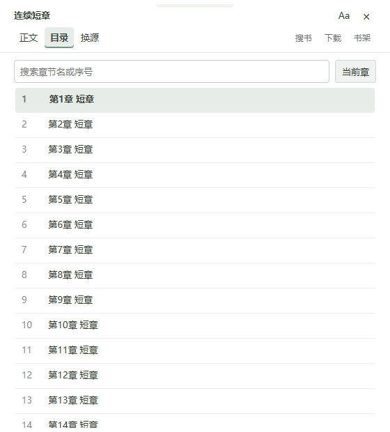
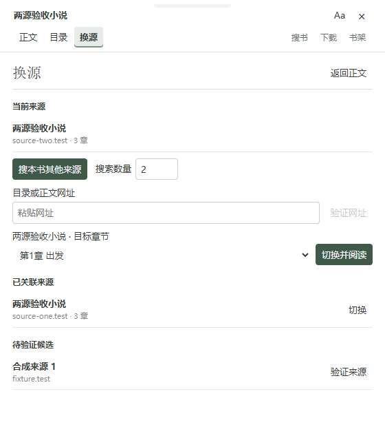
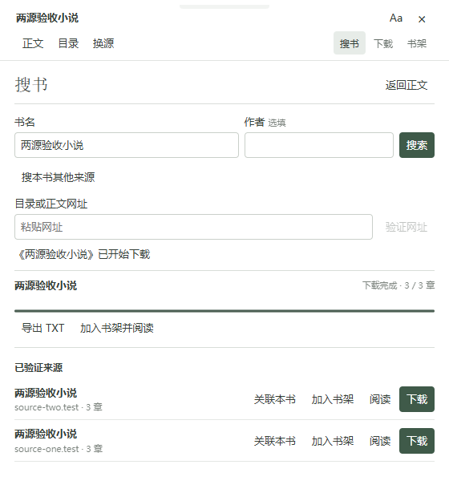
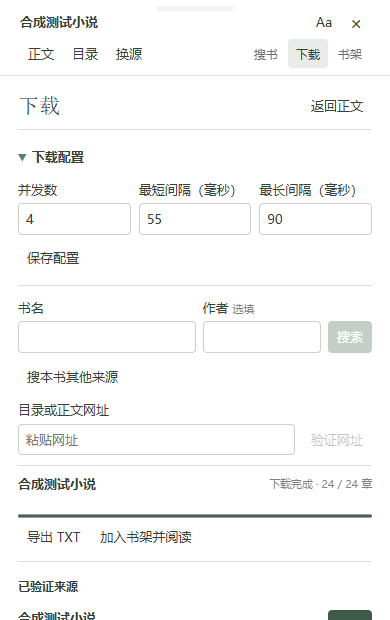
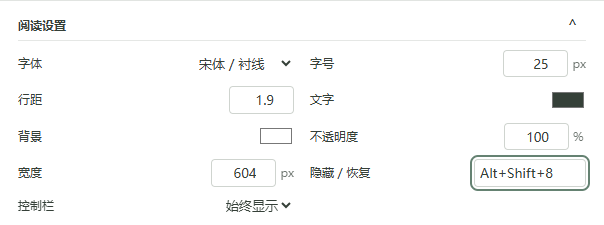

# 页间使用手册

适用于页间 `v0.1.3`，面向桌面 Chrome 和 Edge。下文截图来自隔离 Edge 和合成小说，站点名与界面数值仅供演示。

[安装和更新](#安装和更新) · [打开与移动浮窗](#打开与移动浮窗) · [阅读与目录](#阅读与目录) · [搜书与换源](#搜书与换源) · [下载与导出](#下载与导出) · [书架和-txt-导入](#书架和-txt-导入) · [快捷键](#快捷键) · [常见问题](#常见问题)

## 安装和更新

1. 从 [GitHub Releases](https://github.com/MaSiBo1998/page-between/releases/latest) 下载 `page-between-0.1.3-chromium.zip` 并解压。Chrome 和 Edge 用同一个包；不要下载 `Source code` 作为安装包。
2. 地址栏打开 `chrome://extensions` 或 `edge://extensions`，开启「开发者模式」，选择「加载已解压的扩展程序」，选中**直接包含 `manifest.json`** 的文件夹。
3. 在浏览器工具栏的扩展菜单中固定「页间」。打开普通 HTTP/HTTPS 网页，点扩展图标，再点「在当前网页悬浮阅读」。

可选校验：下载同名 `.sha256` 文件，运行 `Get-FileHash .\page-between-0.1.3-chromium.zip -Algorithm SHA256`，比对摘要。

**升级旧版**：先导出重要内容，备份原安装目录。用新版文件更新同一个安装目录，并在扩展管理页点「重新加载」，随后刷新原网页再打开浮窗。不要先卸载旧扩展；把新版单独装到另一个目录可能产生独立的扩展 ID 和书架数据。书架与阅读进度只保存在本机，无法跨浏览器同步。

## 打开与移动浮窗

- 浮窗依附当前网页。切换标签页时不会跟随；刷新后可再次打开，已保存的阅读位置会恢复。
- 在正文、标题或非交互空白处按住左键直接拖动。移动到边缘可调整宽或高，移动到角落可同时调宽高。输入框及功能按钮保留普通点击、输入行为。
- 阅读时把鼠标移到浮窗顶部，可显示「正文 / 目录 / 换源」和「搜书 / 下载 / 书架」。点击 `Aa` 可调字体、字号、行距、背景、透明度和快捷键，点击正文或收起按钮退出设置。

## 阅读与目录

1. 在线阅读：打开「搜书」，粘贴目录网址或带目录链接的正文网址，点击「验证网址」，验证通过后点「阅读」。也可以从已验证的搜索结果开始阅读。
2. 本地阅读：打开「书架」，选择已有书籍或导入 TXT。翻读会保存阅读位置。
3. 点「目录」查看章节，搜索章节名或滚动浏览并点击目标章。长目录滚动到底会自动加载下一批。滚动阅读时下一章按需接上；在线正文加载失败时，可在正文尾部点「重试加载」。

## 搜书与换源

1. 「搜书」输入书名和可选作者，点「搜索」。当前阅读不会被搜索页抢占。首次读取 Bing 结果时，浏览器会请求网站权限。
2. 点击「验证来源」后按提示授权。来源识别出目录并读到样章后，可阅读、加入书架或下载。只想下载时，可直接点「验证并下载」。
3. 正在读的书要换源时，打开「换源」，用「搜本书其他来源」搜索（默认 10 项，可调），或粘贴网址手动验证。在通过验证的来源上可选「关联本书」，后续直接从已关联来源切换。
4. 切换优先匹配唯一同章；缺章、章号冲突或不能唯一匹配时，从目标目录手选。只有目标章正常加载才切换，并从该章开头开始；失败保留原书进度。同名书不会被自动合并。

搜书范围仅为可读取的 **Bing 首页普通结果**，不是全网爬取。不支持的默认搜索引擎、拒绝授权、搜索页验证等情况，可以打开搜索结果页后手动粘贴网址。扩展不绕过登录、订阅、验证码或限流。

## 下载与导出

1. 在浮窗或扩展弹窗选择「下载」，可搜书或验证粘贴的网址。在「搜书」结果里也能直接下载。
2. 点「验证并下载」或已验证来源旁的「下载」，开始抓取识别到的章节。下载不需要加入书架，一次只运行一个任务。
3. 「下载配置」默认收起，点击标题可展开。调整并发数和请求间隔后点「保存配置」，只影响新任务。站点限流时可降低并发、加长间隔；正在运行的任务不会被设置变更打断。
4. 下载中可暂停，随后继续或取消。关闭浮窗不暂停下载；浏览器重启后，若任务停在暂停状态，重新打开「下载」点「继续下载」。
5. 已保存正文可「导出 TXT」，也可点「加入书架并阅读」。任务暂停或取消后，可导出已经保存的部分正文。仅看到「下载完成」表示正文已收集，**还需要点「导出 TXT」才会生成文件**。

## 书架和 TXT 导入

- 已开始阅读的书会加入书架。搜书验证成功后，也可以点「加入书架」而不打开正文。验证或下载本身不会自动加入书架。
- 点击「书架 → 导入 TXT」选择本机文件，最大 32 MiB。乱码时可选择 UTF-8、GBK 或对应 UTF-16 编码后重新导入。
- 点击书名继续阅读；点击「删除」会移除该书及其本机阅读位置和缓存。删除前请保留原 TXT 或导出需要保存的内容。

## 快捷键

| 操作 | 默认按键 |
| --- | --- |
| 隐藏 / 恢复整个浮窗 | `Alt+R`，可在阅读设置自定义 |
| 隐藏浮窗 | `Esc`，编辑输入时不会触发 |
| 显示 / 直接隐藏浮窗 | `Alt+Shift+1` / `Alt+Shift+2` |
| 显示 / 仅隐藏工具栏 | `Alt+Shift+3` / `Alt+Shift+4` |

自定义：点 `Aa` →「隐藏 / 恢复」，直接按下组合键，或输入 `Alt+K` 后按回车。录入时不会触发整窗隐藏；无效组合或与页间默认浏览器快捷键冲突时，会提示并保留原设置。

四个浏览器级快捷键在 `chrome://extensions/shortcuts` 或 `edge://extensions/shortcuts` 单独设置。注意 `Alt+Shift+4` 只收起工具栏，正文仍可见；要连正文一起隐藏，请用「隐藏 / 恢复」或「直接隐藏浮窗」。

## 常见问题

| 现象 | 处理办法 |
| --- | --- |
| 点击页间没浮窗 | 到普通 HTTP/HTTPS 网页再打开。扩展管理页、新标签页、应用商店等受保护页面不能注入。更新后请刷新原网页。 |
| 找不到书或读不到搜索结果 | 尝试书名加作者；如果无法读取 Bing，手动打开搜索结果，再粘贴具体小说目录网址。 |
| 来源已验证，后续仍有章节报错 | 验证只检查目录和样章，不保证整本可读。可尝试其他来源；遇到访问限制不要反复重试。 |
| 快捷键无效 | 确认录入值，试用 `Alt+K` 等未占用组合。浏览器级快捷键冲突请在扩展快捷键页检查。 |
| 下载完成，但找不到 TXT | 回到「下载」点「导出 TXT」，然后查浏览器下载列表。 |
| 更新后书架空了 | 检查是不是加载了不同安装目录或浏览器配置。先回到原扩展，不要卸载或删除旧数据。 |

更多：[更新记录](../CHANGELOG.md) · [隐私说明](../PRIVACY.md) · [兼容与验证记录](testing.md)
